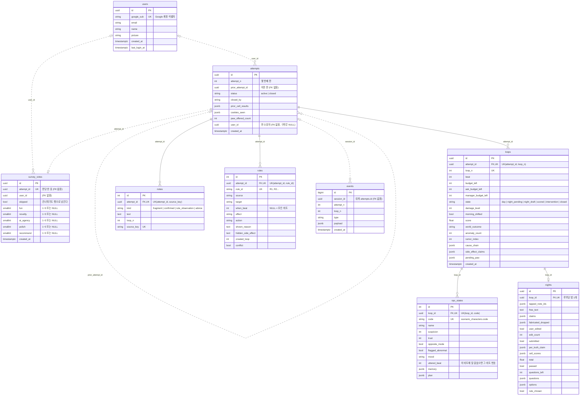
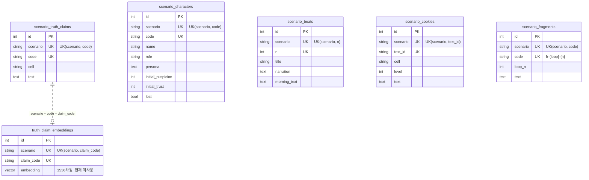

# REMAKE DAY — ERD

- 기준: alembic head `216f290d03b3` (survey_votes), 2026-10-01 개발 DB 제약 조건과 대조
- 정본: `backend/apps/engine/adapter/outbound/orms/*.py` — 이 문서는 그 모델을 그림으로 옮긴 것이다
- 실선 = DB에 외래 키가 있는 관계, 점선 = 코드로만 지키는 관계(외래 키 없음)

## 1. 게임 상태·계정·로그

## 2. 시나리오 시드 (참조 데이터)

매 기동 때 자연키 기준으로 upsert 한다. 테이블끼리도, 게임 상태 테이블과도 외래 키가 없고 `scenario` 문자열과 코드 값으로만 이어진다.

## 3. 읽을 때 주의할 점

- **외래 키는 5개뿐이다.** `loops`·`notes`·`rules` → `attempts`, `npc_states`·`nights` → `loops`. 나머지 관계는 전부 애플리케이션 코드가 지킨다.
- **`attempts.user_id`** 는 판 소유 판정의 유일한 기준이다(`AttemptRepository.get_owned`). 로그인 도입 전에 만든 판은 NULL 이고 누구의 것도 아니다.
- **`events.session_id`** 는 보통 `attempts.id` 지만, 판이 만들어지기 전에 막힌 요청(일일 정원·사용자 한도 가드)은 일회용 UUID 로 기록되므로 `attempts` 에 짝이 없는 행이 있다. 인덱스: `session_id`, `(session_id, type)`.
- **`survey_votes`** 는 CHECK 제약으로 점수 범위(1~5)와 건너뛰기 일관성(건너뛰면 점수 0개, 아니면 1개 이상)을 강제한다.
- **`npc_states.code`** 는 `scenario_characters.code` 값을 루프 시작 시 복사한 것이다. 시드가 바뀌어도 진행 중인 루프의 행은 따라 바뀌지 않는다.
- **`truth_claim_embeddings`** 는 스키마만 있고 런타임에서 쓰지 않는다. 컬럼 규격은 1536차원이고 실제 임베딩 차원 설정(`Settings.embedding_dimensions`)과 다르다.
